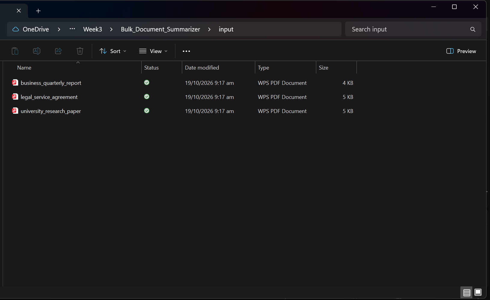
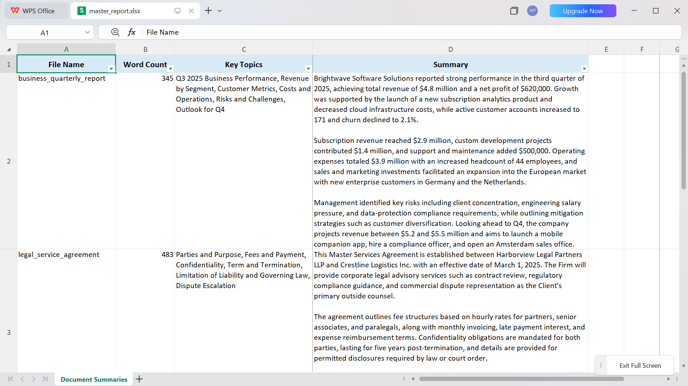
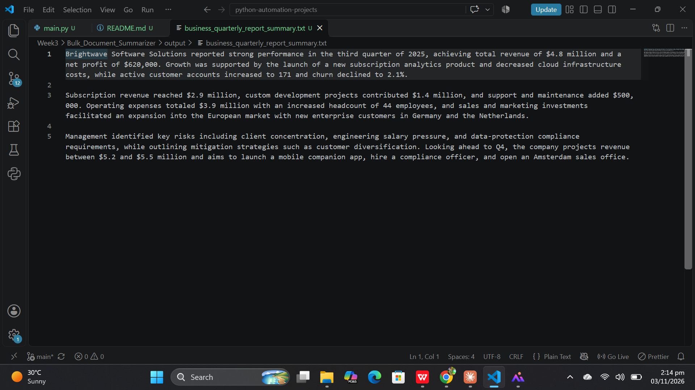

# Bulk Document Summarizer

A Python script that summarizes every PDF in a folder. For each document it extracts the text with `pdfplumber`, asks the Gemini API (`gemini-3.5-flash-lite`) for a three-paragraph summary and a list of key topics, saves the summary as a text file, and collects everything into one Excel report.

Built as part of Week 3 of an AI Automation learning roadmap (document automation). This is a first working version, and its known limitations are listed openly [below](#known-limitations).

**Quick links:** [main.py](https://github.com/codesbybilal/python-automation-projects/blob/main/Week3/Bulk_Document_Summarizer/main.py) | [input folder](https://github.com/codesbybilal/python-automation-projects/tree/main/Week3/Bulk_Document_Summarizer/input) | [output folder](https://github.com/codesbybilal/python-automation-projects/tree/main/Week3/Bulk_Document_Summarizer/output) | [Download master_report.xlsx](https://github.com/codesbybilal/python-automation-projects/raw/main/Week3/Bulk_Document_Summarizer/output/master_report.xlsx)

## How it works

```
input/*.pdf  ->  pdfplumber  ->  text  ->  Gemini (JSON schema)  ->  summary + key topics
                                                                          |
                    output/<name>_summary.txt  <-  one file per document  |
                    output/master_report.xlsx  <-  one row per document  <-
```

1. The script finds every `.pdf` file in the `input/` folder.
2. `pdfplumber` extracts the text from every page, and the word count is calculated in Python.
3. The text is sent to Gemini, which returns a JSON object with a three-paragraph `summary_paragraphs` and a list of `key_topics`.
4. The summary is saved to `output/<filename>_summary.txt`.
5. A row is added to the report, which is saved as `output/master_report.xlsx`.

## Demo

### Input: the documents to summarize




### Output: the master report



[Download the sample report (master_report.xlsx)](https://github.com/codesbybilal/python-automation-projects/raw/main/Week3/Bulk_Document_Summarizer/output/master_report.xlsx)

### Output: an individual summary





[Open an example summary file](https://github.com/codesbybilal/python-automation-projects/blob/main/Week3/Bulk_Document_Summarizer/output/business_quarterly_report_summary.txt) | [Browse all generated summaries](https://github.com/codesbybilal/python-automation-projects/tree/main/Week3/Bulk_Document_Summarizer/output)

**Sample documents:** [REPLACE: describe the documents in input/, for example "three public PDFs about ...". Use only public or fictional documents here.]

## What it produces

**One summary file per document:** `output/<filename>_summary.txt`.

**One Excel report, `output/master_report.xlsx`, with one row per processed document:**

| Column | Content |
|--------|---------|
| File Name | The PDF's name without the extension |
| Word Count | Number of words in the extracted text, counted by the script |
| Key Topics | The main topics, comma-separated (generated by the model) |
| Summary | The three-paragraph summary (generated by the model) |

The report has a styled header, wrapped text, set column widths, a frozen header row and a filter on every column.

### What happens in each situation

| Situation | Result |
|-----------|--------|
| Normal PDF | Summary file written and a full report row added |
| PDF has no extractable text (for example a scan) | Report row with `No text is found in the pdf.`, no summary file |
| The API call fails | Report row with `AI failed to generate a response.`, no summary file |
| The model's reply is not valid JSON | Report row with `Failed to parse the JSON.`, no summary file |
| The model returns no summary | Report row with `Unable to generate summary.`, no summary file |
| The model returns no key topics | Report row with `No key topics are found from text.` |
| The file cannot be opened (corrupted, renamed non-PDF, password-protected) | Message printed in the console only: no report row and no summary file (see limitation 1) |

## Setup

1. Install the dependencies:
   ```bash
   pip install google-genai python-dotenv pdfplumber openpyxl
   ```
2. Create a `.env` file in the project folder (`Week3/Bulk_Document_Summarizer`) with your Gemini API key:
   ```
   GEMINI_API_KEY=your_key_here
   ```
3. Put the PDFs you want to summarize in the `input/` folder. The folder must exist. The `output/` folder is created automatically if it is missing.
4. Run the script from the project folder, because the folder names are relative paths:
   ```bash
   python main.py
   ```

Close `master_report.xlsx` in Excel before running, since the script overwrites it.

## Known limitations

This is version 1. These are the gaps I know about, in order of importance:

1. **Files that cannot be opened get no report row.** A corrupted file, a renamed non-PDF or a password-protected PDF only prints a message in the console. The report then has fewer rows than there are files, so a missing row can mean a failed file.
2. **No retry.** If an API call fails (for example a dropped connection), the document is recorded as failed straight away. The cause of the failure is not printed or saved.
3. **No rate-limit handling.** There is no pause between documents. On the free tier, in my earlier testing, requests started failing after roughly 14 calls in a minute, so a large batch will start recording failures partway through.
4. **The report is saved once, at the end.** If the script stops partway, or `master_report.xlsx` is open in Excel when it finishes, the whole report is lost. The individual summary files are written as it goes, so they survive.
5. **No resume.** Running the script again processes every document again, which costs API calls, and overwrites the previous results.
6. **No limit on document length.** The full text is sent in one request. A very long PDF can be slow, expensive, or too large for the model, and there is no splitting into chunks.
7. **The summary format is not checked.** The prompt asks for exactly three paragraphs, but the script does not verify it, and the paragraphs are separated by a single new line.
8. **Errors and results share the same columns.** Failure messages are written into the Key Topics and Summary cells, so there is no separate Status column to filter on.
9. **Text extraction limits.** There is no OCR, so scanned PDFs produce no text, and some multi-column layouts can come out of `pdfplumber` in the wrong order.
10. **Only `.pdf` files are picked up.** Other formats are ignored, and on case-sensitive systems a file named `.PDF` may be missed.
11. **Code structure.** The script is one block of code with deeply nested logic and no functions, which makes it hard to test and extend.

### Planned improvements

I plan to rebuild this project from scratch using the OpenAI API and fix the points above: a report row and a status for every file, retries with a pause between documents, saving the report safely, skipping documents that are already done, a length limit, and splitting the code into small functions.

## Files

| File | Description |
|------|-------------|
| [`main.py`](https://github.com/codesbybilal/python-automation-projects/blob/main/Week3/Bulk_Document_Summarizer/main.py) | The script |
| [`input/`](https://github.com/codesbybilal/python-automation-projects/tree/main/Week3/Bulk_Document_Summarizer/input) | The PDFs to summarize |
| [`output/`](https://github.com/codesbybilal/python-automation-projects/tree/main/Week3/Bulk_Document_Summarizer/output) | Generated summaries and the Excel report |
| [`output/master_report.xlsx`](https://github.com/codesbybilal/python-automation-projects/raw/main/Week3/Bulk_Document_Summarizer/output/master_report.xlsx) | The Excel report (opens as a download) |

## Related projects

- [CV Parser](https://github.com/codesbybilal/python-automation-projects/tree/main/Week3/CV_Parser): turns a CV in PDF format into structured JSON
- [Excel AI Feedback](https://github.com/codesbybilal/python-automation-projects/tree/main/Week3/Excel_AI_Feedback): writes AI-generated feedback comments into an Excel sheet
- [All Week 3 projects](https://github.com/codesbybilal/python-automation-projects/tree/main/Week3) | [Back to the main repository](https://github.com/codesbybilal/python-automation-projects)

## Privacy

Documents often contain personal or confidential information. The sample documents in this project are public or fictional. Do not commit real client documents, or the summaries generated from them, to a public repository.