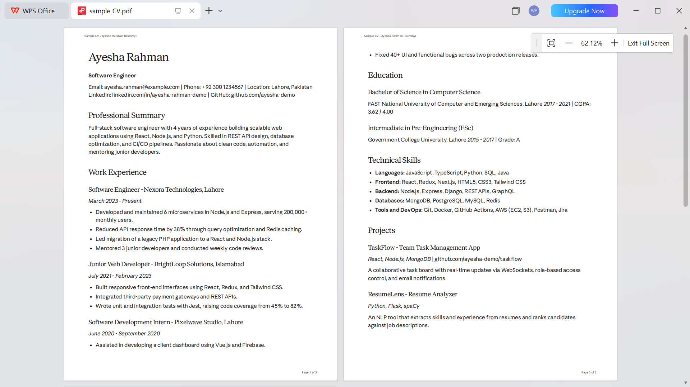
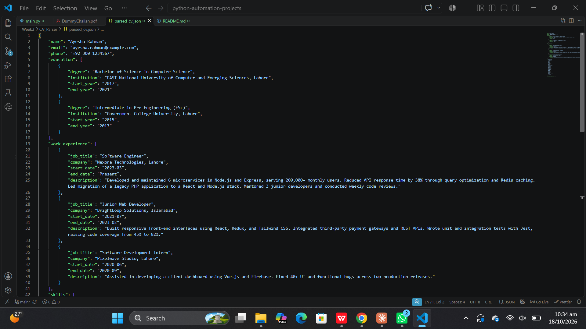

# CV Parser

A Python tool that takes a CV or resume in PDF format and turns it into structured JSON: contact details, education, work experience, skills and total years of experience. Text is extracted with `pdfplumber`, structured with the Gemini API (`gemini-3.5-flash-lite`), and the experience total is calculated in Python.

Built as part of Week 3 of an AI Automation learning roadmap (document automation).

## How it works

```
CV (PDF)  ->  pdfplumber  ->  raw text  ->  Gemini (JSON schema)  ->  structured data
                                                                          |
                          parsed_cv.json  <-  total experience (Python)  <-
```

1. The script asks for the path of a PDF and checks that the file exists and is a `.pdf`.
2. `pdfplumber` extracts the text from every page.
3. The text goes to Gemini with a system prompt and a response schema, so the model returns a JSON object in a fixed shape.
4. The script calculates `total_years_experience` itself from the job dates (see below), replacing any value from the model.
5. The result is saved to `parsed_cv.json`.

## Demo

### Input: a CV



### Output: the parsed JSON



The sample CV is fictional (Ayesha Rahman) and contains no real personal data.

## Features

- **Structured output.** Education and work experience are lists of objects, not loose text, so the result can be searched, sorted and stored.
- **No guessing.** The prompt tells the model to use only what is in the CV. Missing text fields come back as an empty string, missing lists as empty lists, and a missing number as `null`.
- **Reliable experience total.** The model only extracts dates. Python calculates the total, so overlapping jobs are not counted twice, gaps between jobs are left out, and "present" means today.
- **Input checks.** Handles a missing file, a non-PDF file, a PDF that cannot be read, and a PDF with no extractable text.
- **Unicode-safe output.** The JSON is written in UTF-8, so non-English names stay readable.

## Output format

| Field | Type | Notes |
|-------|------|-------|
| `name` | string | Candidate's name |
| `email` | string | Contact email |
| `phone` | string | Contact phone number |
| `education` | list of objects | Each has `degree`, `institution`, `start_year`, `end_year` |
| `work_experience` | list of objects | Each has `job_title`, `company`, `start_date`, `end_date`, `description` |
| `skills` | list of strings | All skills found in the CV |
| `total_years_experience` | number or `null` | Calculated by the script, in years, rounded to one decimal |

Work experience dates use the format `YYYY-MM`, or `"present"` for a current job.

<details>
<summary>Full example output (fictional CV)</summary>

```json
{
    "name": "Ayesha Rahman",
    "email": "ayesha.rahman@example.com",
    "phone": "+92 300 1234567",
    "education": [
        {
            "degree": "Bachelor of Science in Computer Science",
            "institution": "FAST National University of Computer and Emerging Sciences, Lahore",
            "start_year": "2017",
            "end_year": "2021"
        },
        {
            "degree": "Intermediate in Pre-Engineering (FSc)",
            "institution": "Government College University, Lahore",
            "start_year": "2015",
            "end_year": "2017"
        }
    ],
    "work_experience": [
        {
            "job_title": "Software Engineer",
            "company": "Nexora Technologies, Lahore",
            "start_date": "2023-03",
            "end_date": "Present",
            "description": "Developed and maintained 6 microservices in Node.js and Express, serving 200,000+ monthly users. Reduced API response time by 38% through query optimization and Redis caching. Led migration of a legacy PHP application to a React and Node.js stack. Mentored 3 junior developers and conducted weekly code reviews."
        },
        {
            "job_title": "Junior Web Developer",
            "company": "BrightLoop Solutions, Islamabad",
            "start_date": "2021-07",
            "end_date": "2023-02",
            "description": "Built responsive front-end interfaces using React, Redux, and Tailwind CSS. Integrated third-party payment gateways and REST APIs. Wrote unit and integration tests with Jest, raising code coverage from 45% to 82%."
        },
        {
            "job_title": "Software Development Intern",
            "company": "Pixelwave Studio, Lahore",
            "start_date": "2020-06",
            "end_date": "2020-09",
            "description": "Assisted in developing a client dashboard using Vue.js and Firebase. Fixed 40+ UI and functional bugs across two production releases."
        }
    ],
    "skills": [
        "JavaScript", "TypeScript", "Python", "SQL", "Java", "React", "Redux",
        "Next.js", "HTML5", "CSS3", "Tailwind CSS", "Node.js", "Express", "Django",
        "REST APIs", "GraphQL", "MongoDB", "PostgreSQL", "MySQL", "Redis", "Git",
        "Docker", "GitHub Actions", "AWS", "Postman", "Jira"
    ],
    "total_years_experience": 5.7
}
```

</details>

## Setup

1. Install the dependencies:
   ```bash
   pip install google-genai python-dotenv pdfplumber
   ```
2. Create a `.env` file in this folder with your Gemini API key:
   ```
   GEMINI_API_KEY=your_key_here
   ```
3. Run:
   ```bash
   python main.py
   ```
   and enter the path of a CV when prompted:
   ```
   Enter the path of the pdf file: my_cv.pdf
   ```

The result is saved to `parsed_cv.json` in the same folder.

## How total experience is calculated

Language models are unreliable at date arithmetic, and they do not know today's date, so a job ending in "present" gives them nothing solid to count from. This tool splits the work:

- **The model** extracts each job's start and end date as `YYYY-MM`.
- **Python** converts every date to a month number, turns each job into a range of months, and calculates the total.

The rules:

- **Overlapping jobs** are merged, so a month worked in two jobs counts once.
- **Gaps** between jobs are not counted.
- **"present"** means the month the script runs.
- **Both the start month and the end month are counted.** June 2020 to September 2020 is 4 months, and a job ending in February followed by one starting in March counts as continuous.
- **Jobs with a missing or malformed date** are skipped, and a warning with the company name is printed.
- If no job has a usable date, `total_years_experience` is `null`.

Because "present" means today, the same CV gives a slightly larger number when it is parsed later.

## Error handling

| Situation | What happens |
|-----------|--------------|
| File does not exist | Message printed, script stops |
| File is not a PDF | Message printed, script stops |
| PDF cannot be opened or read | Error shown, script stops |
| PDF has no extractable text (for example a scan) | Message printed, script stops |
| Model returns invalid JSON | Message printed, script stops |
| A job has a missing or malformed date | That job is skipped with a warning, the rest are processed |

## Known limitations

- **No OCR.** Scanned or image-only CVs have no text layer and cannot be parsed.
- **Multi-column layouts.** Some CVs with a sidebar can come out of `pdfplumber` with the text in the wrong order, which affects the model's output. Check the extracted text on layouts you have not tested.
- **One CV per run, and a fixed output filename.** Each run overwrites `parsed_cv.json`.
- **No retry.** A failed API call (for example a dropped connection) ends the run.
- **Email and phone are not verified.** They are returned as the model read them and are not checked against the CV text.
- **Locations are merged into other fields.** The city appears inside the company and institution names, because the schema has no separate location field.
- **Date format depends on the model.** If a date comes back in another format, that job is left out of the experience total.

## Files

| File | Purpose |
|------|---------|
| `main.py` | The parser |
| `parsed_cv.json` | Sample output generated from the fictional CV |
| `cv_input.png`, `cv_output.png` | Screenshots used in this README |

## Privacy

A CV contains personal data. Do not commit real CVs or their parsed output to a public repository. The sample in this project is fictional.
