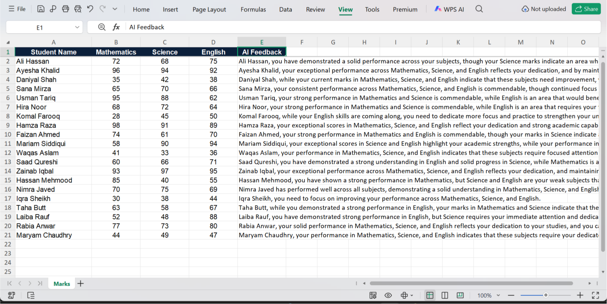

# Excel AI Feedback

A Python script that reads student marks from an Excel file, generates a one-sentence personalised feedback comment for each student using the Gemini API (`gemini-3.5-flash-lite`), and writes the comments back into a new column in the same workbook.

Built as part of Week 3 of an AI Automation learning roadmap (document automation).

## What it does

Given a sheet like this:

| Student Name | Mathematics | Science | English |
|--------------|-------------|---------|---------|
| Usman Tariq  | 95          | 88      | 62      |

it adds an **AI Feedback** column (E) with a comment based strictly on that student's marks.

## Features

- **Reads marks with `openpyxl`** and sends each student's data to the model in a separate call.
- **Rule-based feedback.** The system prompt defines the marking scheme: marks are out of 100, below 50 is a fail and counts as a weak subject, 50 to 64 is passing but needs improvement, and 65 and above is not treated as weak.
- **Retries on failure.** Each student gets up to 3 attempts, with a short wait between them, so a network blip doesn't lose a row.
- **Resumable.** Results are saved after every student. On a rerun, the script loads the output file and skips rows that already have feedback. Rows that failed or were missing marks are tried again.
- **Handles bad rows.** Blank rows are skipped silently. A student with a missing mark gets a visible message in column E instead of an API call.
- **Tracks API usage.** Prints the total number of API calls at the end.

## Setup

1. Install the dependencies:
   ```bash
   pip install google-genai python-dotenv openpyxl
   ```
2. Create a `.env` file in this folder with your Gemini API key:
   ```
   GEMINI_API_KEY=your_key_here
   ```
3. Put your marks in `sample.xlsx` (or use the included sample). Expected layout: names in column A, then Mathematics, Science and English in columns B to D, with a header in row 1.
4. Close the workbook in Excel, then run:
   ```bash
   python main.py
   ```

The results are saved to `sample_with_feedback.xlsx`. Your input file is not modified.

## Example output

```
Usman Tariq, Maths 95, Science 88, English 62 Feedback: Usman Tariq, your strong performance in Mathematics (95) and Science (88) is commendable, while your score in English (62) indicates an area that needs improvement.
Hamza Raza, Maths 98, Science 91, English 89 Feedback: Hamza Raza, your scores of 98 in Mathematics, 91 in Science, and 89 in English reflect a very strong performance across all your subjects.
Komal Farooq, Maths 28, Science 45, English 50 Feedback: Komal Farooq, while your English score of 50 shows you are meeting basic expectations, your performance in Mathematics (28) and Science (45) needs significant improvement.
Total API calls made: 20
```


### What ends up in column E

| Situation | Column E contains |
|-----------|-------------------|
| Normal row | The generated feedback sentence |
| A mark is blank | `Missing marks, feedback not generated.` |
| All 3 attempts failed | `Something went wrong with feedback generation.` |
| Row has no name | Left untouched |

## Files

| File | Purpose |
|------|---------|
| `main.py` | The script |
| `sample.xlsx` | Sample input: 20 invented students with a spread of strong, average and weak marks |
| `sample_with_feedback.xlsx` | Sample output generated by the script |

## Technical notes

- Each student is a separate API call, so 20 students means 20 calls (plus any retries).
- The free tier of the Gemini API has a per-minute request limit. The script pauses for 60 seconds once, at the 14th API call, to stay under it.
- Resuming works because the output file is loaded first if it exists. Delete `sample_with_feedback.xlsx` to start from scratch.

## Known limitations

- The 60-second pause is a fixed workaround tuned to the free tier. It triggers once, so a much larger sheet could hit the limit again. A better version would react to rate-limit errors or pace every call.
- The marking scheme (out of 100, pass mark 50) is written into the system prompt. A different scheme means editing the prompt.
- The column layout is fixed: three subjects in columns B to D, feedback in column E.
- Feedback quality depends on the model. Borderline marks, such as a 50 or a 65, can be described slightly more leniently than the rules say, so spot-check the results before sharing them.
